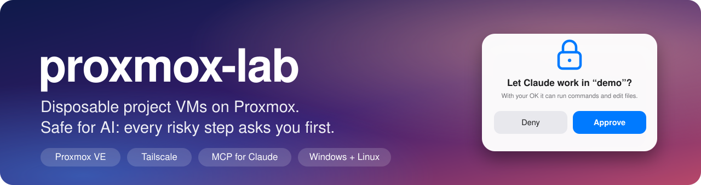
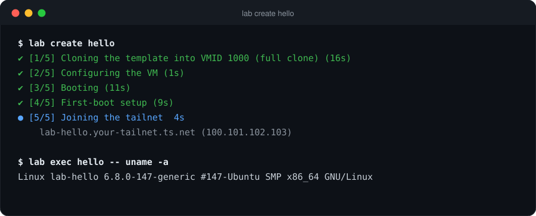
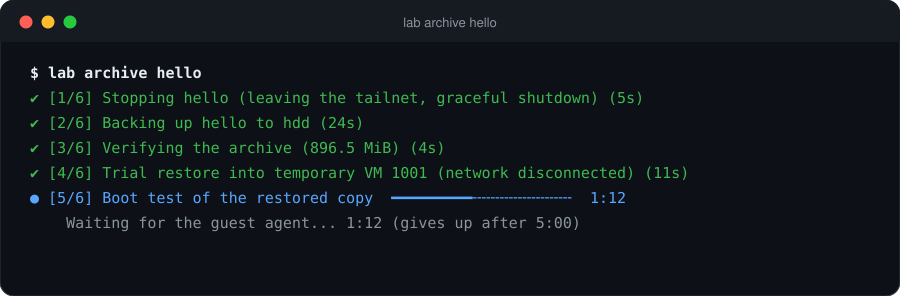
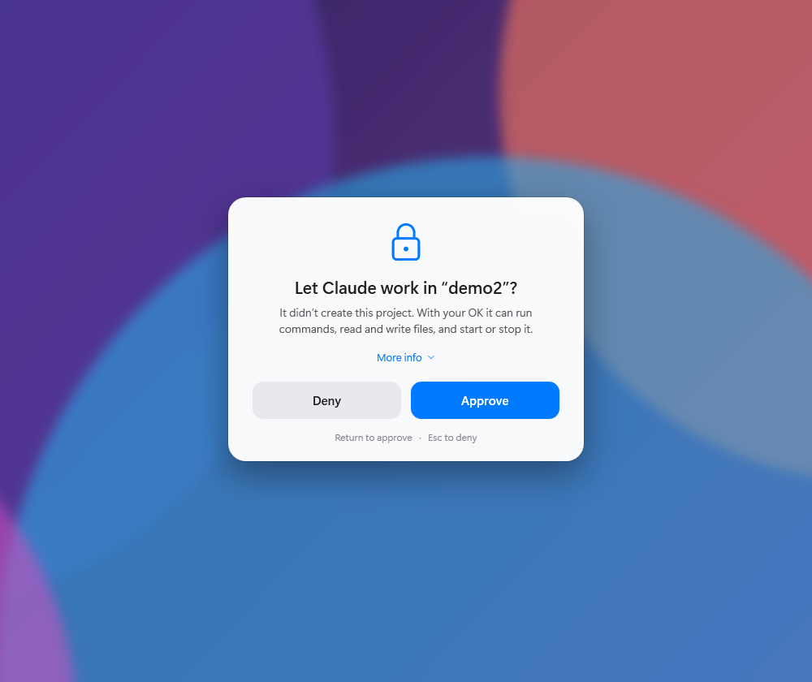
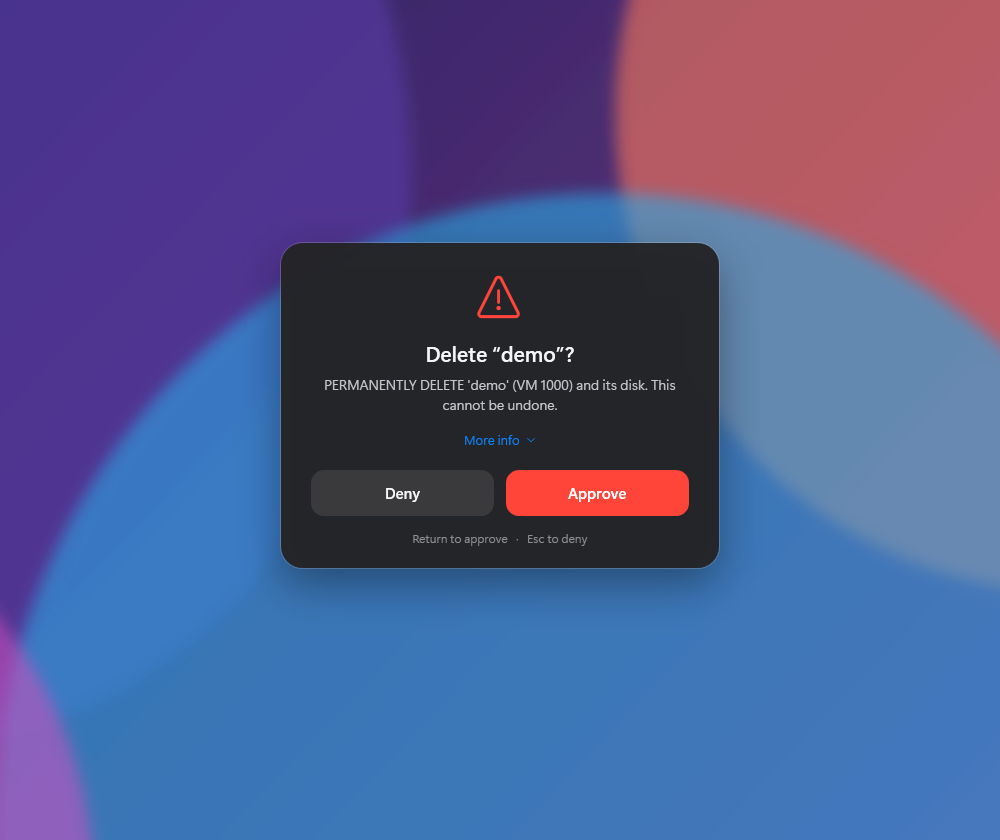
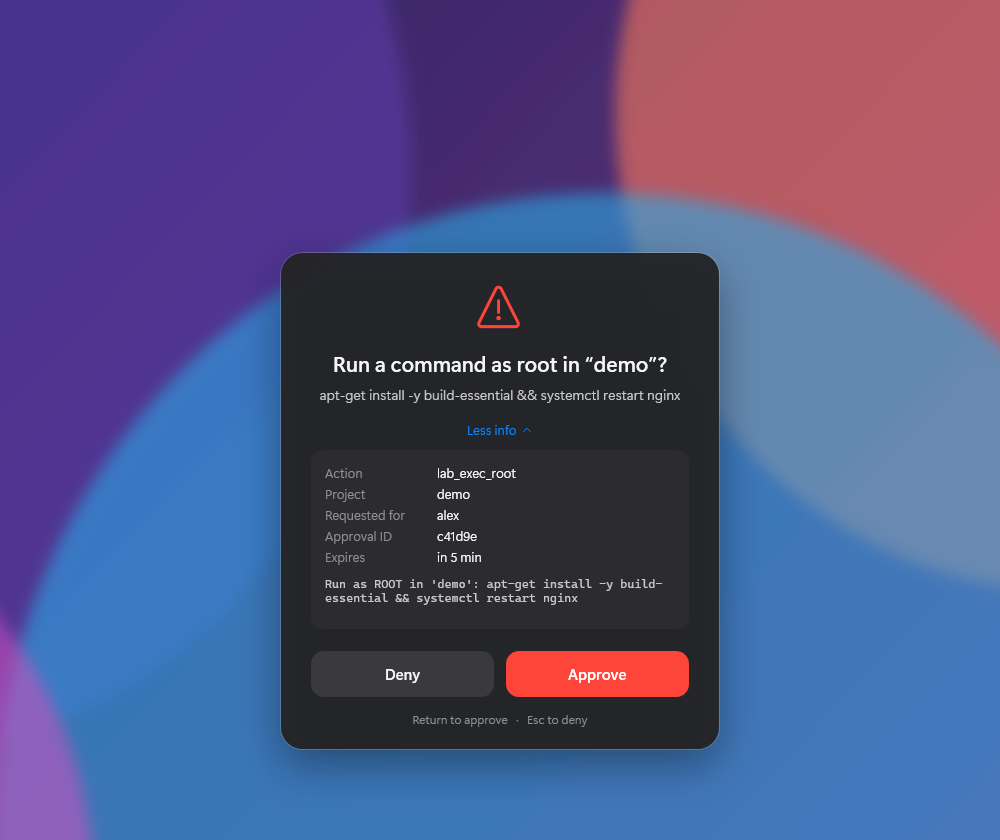
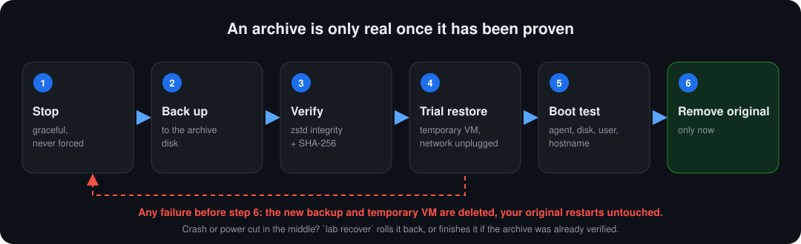
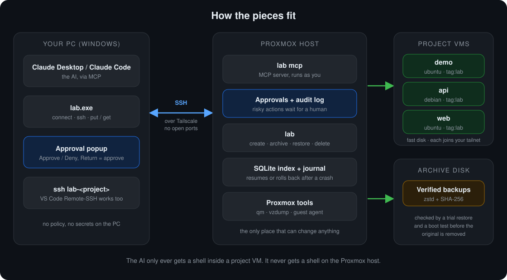

<p align="center">
  
</p>

<p align="center">
  <a href="https://github.com/madmaxvoltro/proxmox-lab/actions/workflows/ci.yml"></a>
  <a href="https://github.com/madmaxvoltro/proxmox-lab/releases/latest"></a>
  <a href="LICENSE"></a>
  
  
  
</p>

**proxmox-lab** turns a Proxmox server into a personal project cloud. One command gives you a fresh Ubuntu or Debian VM on your fast disk, already on your Tailscale network with SSH working. When you're done with a project, one command moves it to a big archive disk, and only deletes the original after the backup has been proven to restore and boot.

Because the VMs are disposable, they are a good place to let an AI work. A built-in [MCP](https://modelcontextprotocol.io) server gives Claude a shell **inside the VMs only**, and every risky step (delete, archive, running as root, entering a project it didn't create) pops up a window asking **you**.

```text
you@pc:~$ lab create demo        # a fresh VM, on your tailnet, ready in about 40 seconds
you@pc:~$ ssh lab-demo           # or ask Claude to build something in it
you@pc:~$ lab archive demo       # verified backup, then frees the fast disk
you@pc:~$ lab restore demo       # back from the archive, same data, fresh Tailscale identity
```

<p align="center"></p>

## Contents

[Why](#why) · [Install](#install) · [Use it](#use-it) · [Claude (MCP)](#claude-mcp) · [Archives you can trust](#archives-you-can-trust) · [How it fits together](#how-it-fits-together) · [Safety model](#safety-model) · [Commands](#commands) · [Configuration](#configuration) · [Troubleshooting](#troubleshooting) · [Development](#development)

## Why

Spinning up a clean machine for a side project should take seconds, not an evening of clicking through the Proxmox UI. And letting an AI loose on your real servers should never be the price of that.

- **Fast.** Clones a prepared template (Ubuntu 24.04 is the tested one; Ubuntu 22.04/26.04, Debian 12/13, Rocky 9 and Alma 9 are configured and untested; add more with a config entry). Cloud-init sets up your user, Tailscale joins the VM to your tailnet with SSH on.
- **Cleanly separated.** Active projects live on your fast disk. Finished ones live on your archive disk as verified backups. The wizard asks which disk is which and never hard-codes anything.
- **Archives you can trust.** An archive is deleted-from-fast-disk only after a trial restore *and* a boot test succeed. A failed check deletes the new backup and restarts your original. See [below](#archives-you-can-trust).
- **Safe for AI.** The MCP server runs on the host as you. It has no host shell, no raw `qm`, and no way to approve anything itself. Risky steps need a click from you, and every call is written to an audit log.
- **Multi-user ready.** Each user has their own projects, quotas and Tailscale tag, and only sees their own (today every user needs a login that can run `lab` on the host; see [Status](#status)).
- **Nothing to install on the VMs, nothing to open on your router.** Everything travels over Tailscale. The host side is plain Python with no dependencies.

## Install

You need a Proxmox VE host, [Tailscale](https://tailscale.com/download) on that host and on your computer, and a free Tailscale account. Two commands, in this order:

### 1. On the Proxmox host (as root)

```bash
curl -fsSL https://raw.githubusercontent.com/madmaxvoltro/proxmox-lab/main/install.sh | bash
```

It downloads the latest release, verifies its checksum, installs it to `/opt/project-lab`, adds the `lab` command, and starts a guided `lab setup`:

1. checks the host (root, Proxmox version, Tailscale connected),
2. lets you pick the **fast disk** and **archive disk** from what it discovers (it can register a dedicated folder on a mounted disk, and never formats anything),
3. detects whether your network has DHCP and, if not, sets up lab-assigned addresses and VLAN tags,
4. prints the **Tailscale policy** to paste in, and walks you through creating the OAuth credential (and *tests* it),
5. builds the base image,
6. runs a final health check.

It is safe to run again at any time: finished steps are detected and skipped. Update with the same command; your configuration is kept. Remove it with `... | bash -s -- --uninstall` (your VMs, archives and data are never touched).

<details>
<summary>What the installer does, exactly</summary>

- Needs: root, `pveversion`, Python 3.11+ (Proxmox VE 9 ships 3.13), `curl`, `tar`, `sha256sum`.
- Downloads `project-lab-<version>.tar.gz` and `SHA256SUMS` from the GitHub release, refuses to continue on a checksum mismatch.
- Unpacks into `/opt/project-lab/releases/<version>`, points `/opt/project-lab/current` at it (the last three releases are kept for rollback), and writes a two-line `/usr/local/bin/lab` wrapper. It will not overwrite a `lab` it didn't create.
- Pass options after `bash -s --`: `--version v0.1.0`, `--no-setup`, `--uninstall`.
- Don't like piping to bash? Download [`install.sh`](install.sh), read it, run it.
</details>

### 2. On your computer (Windows, macOS or Linux; no admin or sudo needed)

<table>
<tr><th>Windows (PowerShell)</th></tr>
<tr><td>

```powershell
irm https://raw.githubusercontent.com/madmaxvoltro/proxmox-lab/main/install.ps1 | iex
```

</td></tr>
<tr><th>macOS or Linux (Intel/AMD or ARM)</th></tr>
<tr><td>

```bash
curl -fsSL https://raw.githubusercontent.com/madmaxvoltro/proxmox-lab/main/install-client.sh | bash
```

</td></tr>
</table>

Each one downloads the `lab` program for your system and CPU (six builds: Windows, macOS and Linux, each x64 and ARM64), verifies its checksum, installs it (`%LOCALAPPDATA%\Programs\lab` on Windows, `~/.local/bin` elsewhere) and starts **`lab connect`**, which:

1. tests the SSH connection to your host and explains any failure,
2. adds `ssh lab-<project>` shortcuts to your SSH config (VS Code Remote-SSH works),
3. adds the MCP server to **Claude Desktop** for you (backing up its config first),
4. registers it with **Claude Code** if installed,
5. starts the **approval popup** helper and makes it start at login (a Startup entry on Windows, a LaunchAgent on macOS, an autostart entry on Linux).

Remove it later with `lab uninstall`. Check that a computer is ready any time with `lab check`.

## Use it

```bash
lab create demo                       # defaults: 1 vCPU, 2 GB RAM, 32 GB disk, Ubuntu 24.04
lab create api --size medium --distro debian-13
lab list
lab exec demo -- uname -a             # run a command inside it
ssh lab-demo                          # Tailscale SSH, no keys or passwords to manage
lab stop demo   &&   lab start demo   # graceful; Tailscale is handled for you
lab archive demo                      # verified backup, then frees the fast disk
lab restore demo
lab delete demo --archives            # asks you to type the name
```

Size presets are `small` (1 vCPU / 2 GB / 32 GB), `medium` (4 / 8 GB / 48 GB) and `large` (8 / 16 GB / 64 GB), and `--cpu`, `--ram`, `--disk` override them. Slow commands show a live progress window with real percentages and timings:

<p align="center"></p>

## Claude (MCP)

`lab connect` does this for you. If you prefer to do it by hand, add this to Claude Desktop's config (**Settings → Developer → Edit Config**; on macOS the file is `~/Library/Application Support/Claude/claude_desktop_config.json`), using your host's Tailscale name. On macOS and Linux use `"command": "ssh"`:

```json
{
  "mcpServers": {
    "lab": {
      "command": "C:\\Windows\\System32\\OpenSSH\\ssh.exe",
      "args": ["-T", "-o", "BatchMode=yes", "-o", "ServerAliveInterval=30", "root@pve.your-tailnet.ts.net", "lab", "mcp"]
    }
  }
}
```

Then quit Claude Desktop completely (tray icon → Quit) and reopen it. For Claude Code, run `claude mcp add --scope user lab -- ssh -T -o BatchMode=yes root@pve.your-tailnet.ts.net lab mcp`, or put the same block in a project's `.mcp.json`.

The server is started over your own SSH connection (`ssh host lab mcp`), so nothing new listens anywhere, and it runs on the host as **you**, with your quotas and permissions.

| Tool | What it does |
|---|---|
| `lab_list`, `lab_status` | See your projects (protected ones show only a name) |
| `lab_create` | New VM; owned by you, within the caps in the config |
| `lab_start`, `lab_stop`, `lab_restart` | Lifecycle |
| `lab_exec` (+ `_poll`, `_cancel`) | Run commands inside a VM as its user; background jobs for long ones |
| `lab_read_file`, `lab_write_file`, `lab_upload`, `lab_download` | Files inside a VM |
| `lab_archive`, `lab_restore`, `lab_delete` | Always need your approval |
| `lab_attach`, `lab_logs`, `lab_approvals` | Attach to an existing project, history, pending approvals |

### The approval popup

When an AI session needs permission, a window appears. On **Windows** the monitor you are working on blurs and a card shows up: **Return approves, Esc denies**, and *More info* shows exactly what is being asked. **macOS** shows its native dialog (Return approves, Esc denies) and **Linux** uses `zenity` or `kdialog` (install one if you have neither); both show the same details but without the blur.

<table>
<tr>
<td width="33%"></td>
<td width="33%"></td>
<td width="33%"></td>
</tr>
</table>

If the helper is running, the AI's tool call simply waits for your click and then carries on. If it isn't, the call fails with a short approval ID and you can run `lab approve <id>` in a terminal instead. Some MCP clients can show their own prompt (the protocol calls it *elicitation*); lab uses that first when available. Try the popup any time with `lab watch --preview delete`.

## Archives you can trust

<p align="center"></p>

The original VM is the *last* thing removed. If anything fails before that, the new backup and the temporary VM are deleted and your original is restarted exactly as it was. Every step is journaled, so after a crash or a power cut `lab recover <project>` rolls back, or finishes the job if the archive was already verified. Only the newest verified archive is kept by default (`archive.keep`), and an older one is replaced only after its successor verified.

## How it fits together

<p align="center"></p>

- **The host is the only place that can change anything.** Your PC holds no policy and no secrets: approvals, the audit log and the Tailscale credential all live on the host.
- **Identity comes from Tailscale.** The host looks up who is connecting (`tailscale whois`) and maps them to a lab user. No new passwords or tokens.
- **Project VMs carry a dedicated Tailscale tag** (`tag:lab`) plus an owner tag. That tag has no grants of its own, so a project VM cannot reach your other devices unless you write a rule that allows it.
- **A per-VM, single-use, ephemeral Tailscale key** is minted from an OAuth client and piped into the VM through the QEMU guest agent. It is never stored, logged or put in cloud-init.
- **Disks are decided by the host's config only.** Nothing that arrives with a project (a repo file, a client, an AI tool call) can choose where VMs or archives go.

The full design is in [docs/SPEC.md](docs/SPEC.md) and the feature list in [docs/FEATURES.md](docs/FEATURES.md).

## Safety model

| | |
|---|---|
| **AI can** | list its projects, create VMs within your caps, run commands and read/write files **inside** project VMs, start/stop them |
| **AI needs your click for** | delete, archive, restore · any command or file access **as root** · entering a project it didn't create · creating something bigger than the caps · any access to a *protected* project |
| **AI can never** | get a shell on the Proxmox host, run raw `qm`, approve its own requests, change disks or the bridge, see the Tailscale key |
| **Approvals are** | tied to the exact action and arguments, single-use, and expire after 10 minutes |
| **Everything is logged** | `/var/log/project-lab/mcp-audit.log`, secrets redacted; if the log can't be written the action doesn't run |
| **Protected projects** | `lab protect <name>`: visible by name only; stop/archive/delete are refused outright through MCP |

> **One honest limit.** The approval popup approves *as you*, over your SSH identity. If an AI session also has a shell on your PC (for example Claude Code with its Bash tool) it could run the same commands. Keep `lab` and `ssh` out of any auto-approved command list there. Sessions that only have the MCP tools, like Claude Desktop, cannot approve anything.

## Commands

<details>
<summary><b>On the Proxmox host</b> (<code>lab …</code>)</summary>

| Command | |
|---|---|
| `setup` | Guided setup of a fresh host; safe to re-run |
| `init` | Just the storage / network / admin questions |
| `doctor` | Read-only health and drift checks (storage, DHCP/pool, orphans, credentials) |
| `template list \| add \| update \| rm \| check` | Base images (one per distro) |
| `create NAME [--distro --size --cpu --ram --disk --linked]` | New project VM |
| `list [--all]`, `status NAME` | See projects (`--all` is admin only) |
| `start \| stop \| restart NAME` | Lifecycle |
| `archive NAME [--keep-active]`, `restore NAME`, `recover NAME` | Verified archives |
| `delete NAME [--archives]` | Typed-name confirmation; archives need `--archives` |
| `protect \| unprotect NAME` | Mark a project off-limits to AI |
| `exec NAME -- CMD`, `put NAME DST`, `get NAME SRC` | Work inside a VM |
| `user add \| list \| remove` | Manage who may use the lab (admin) |
| `approve ID`, `approvals` | Answer / list AI approval requests |
| `mcp` | The MCP server (started for you over SSH) |
| `--dry-run` | Any command: run read-only parts for real, print the changes instead of making them |
</details>

<details>
<summary><b>On your computer</b> (<code>lab …</code>, forwards everything else to the host)</summary>

| Command | |
|---|---|
| `connect [HOST]` | Guided wiring of this computer: SSH, Claude Desktop, Claude Code, popups |
| `ssh NAME [--via-host]` | Open a project over Tailscale SSH |
| `ssh-config` | Write `lab-<project>` shortcuts into `~/.ssh/config` |
| `mcp-config` | Print the MCP config for Claude |
| `put NAME LOCAL DST`, `get NAME SRC LOCAL` | Copy files (up to 4 MiB; use `scp` to `lab-NAME` for bigger ones) |
| `watch [--install \| --uninstall \| --preview KIND]` | The approval popup helper |
| `check` | Is this PC ready? Shows the bundled files, OpenSSH, Tailscale and your saved host |
| `version`, `uninstall` | |
</details>

## Configuration

`lab setup` writes `/etc/project-lab/config.toml`. The host's config is the **only** place that decides disks, bridge, VMID ranges and Tailscale settings. A few of the knobs:

```toml
[storage]
fast_disk    = "nvme-fast"      # where active projects live
archive_disk = "lab-archive"    # where verified backups live
snippet_disk = "local"          # cloud-init files

[network]
bridge     = "vmbr0"
vlan       = 0                  # tag for VLAN-aware bridges
mode       = "dhcp"             # or "static": lab hands out addresses from pool_start..pool_end

[vm]
default_distro = "ubuntu-24.04"
vmid_range     = [1000, 1999]   # lab only ever touches VMs in this range that it created

[mcp]
max_cpu = 8
max_ram = "16G"
max_running_vms = 6             # creates beyond these need your approval

[quota]                         # per user, admins exempt
max_running_vms = 4
max_cpu = 8
max_ram = "24G"
max_disk = "256G"
```

## Troubleshooting

<details>
<summary><b>The base image build hangs on "Waiting for the guest agent"</b></summary>

The temporary VM got no network. Either your bridge has no DHCP server (run `lab setup` again and choose **static** addresses), or it sits on a VLAN-aware bridge and needs a tag (`lab setup` suggests it from your host interfaces, e.g. `vmbr1.60` → VLAN 60). `lab doctor` shows what lab sees.
</details>

<details>
<summary><b>"cannot determine your tailnet identity" or "not a lab user"</b></summary>

Connect to the host by its **Tailscale name**, not a LAN address; lab identifies you by your Tailscale login. Then an admin adds you: `lab user add you@example.com yourname`.
</details>

<details>
<summary><b>Claude says "APPROVAL REQUIRED" and no popup appears</b></summary>

The helper isn't running on your PC. Start it with `lab watch` (or let `lab connect` install it), or approve in a terminal on the host with `lab approve <id>`. Check `~\.lab\watch.log` if it runs but nothing shows.
</details>

<details>
<summary><b>Windows Defender, SmartScreen or macOS Gatekeeper flags the program</b></summary>

The binaries are built by GitHub Actions from this repository with PyInstaller and are not code-signed, which some antivirus products and macOS Gatekeeper dislike. The installers download with `curl` / PowerShell, which avoids the browser quarantine flag. If you downloaded a binary from the Releases page with a browser on macOS, run `xattr -d com.apple.quarantine ~/Downloads/lab-macos-arm64` once. You can verify any file against the release's `SHA256SUMS`, or install from source: `pip install .` gives the same command with no binary.
</details>

<details>
<summary><b>Can project VMs reach my other VLANs and devices?</b></summary>

On the **tailnet**, no: `tag:lab` has no grants. On your **LAN**, that depends on your own router and Proxmox firewall rules; if your host routes between VLANs with a permissive default, add rules to isolate the lab VLAN. That is deliberately left to you because every network is different.
</details>

## Status

This is **v0.x**. It has been used end to end on one Proxmox VE 9.2 host (create, stop/start, archive, restore, delete, the MCP server and the popup), and the code has a large automated test suite, but treat it as beta software that creates and destroys VMs on your server. Keep real backups of anything you care about.

Known gaps: Proxmox VE 8 is not tested; the Rocky/Alma images are untested; the **Windows** client is the one used day to day, while the macOS and Linux builds are compiled and unit-tested on GitHub's runners but have not been run on real machines yet (reports welcome); non-admin users need an SSH login on the host that can run `lab` (a restricted account for them is not built yet); snapshots, clone and profiles from the [spec](docs/SPEC.md) are not implemented. Not affiliated with Proxmox, Tailscale or Anthropic.

## Development

```bash
git clone https://github.com/madmaxvoltro/proxmox-lab && cd proxmox-lab
python -m unittest discover -s tests -t .        # ~300 tests, no Proxmox needed
```

The tests run against an in-memory fake of Proxmox (`tests/fake_proxmox.py`) and a fake network/disk layer, including failure injection for every step of archive, restore and create. See [CONTRIBUTING.md](CONTRIBUTING.md). Releases are built by GitHub Actions: pushing a `v*` tag runs the tests, builds `lab.exe` for x64 and ARM64, and publishes everything with checksums.

## License

[MIT](LICENSE)
